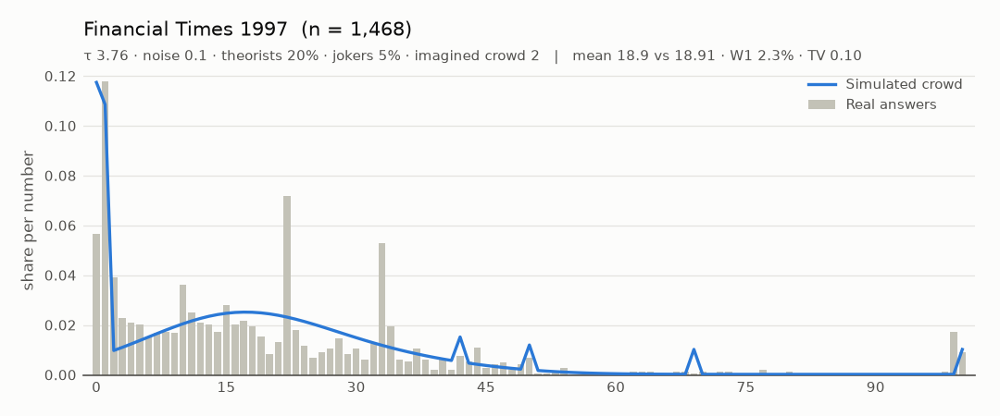
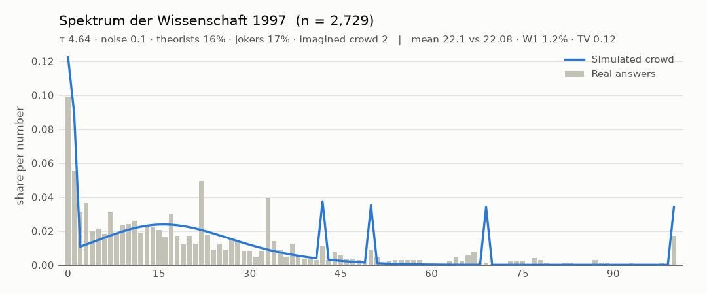
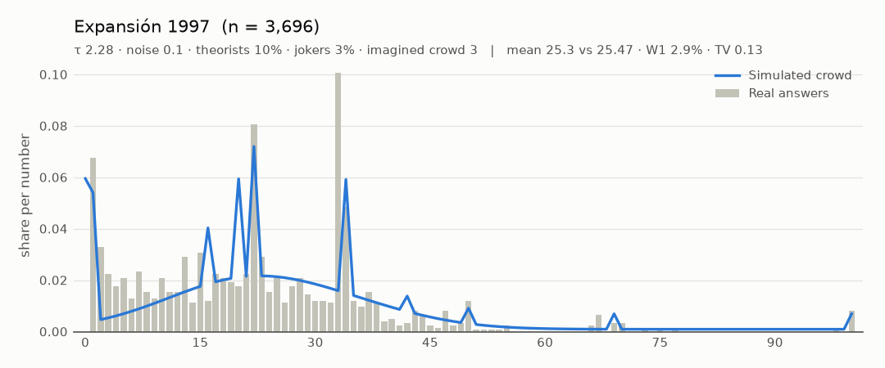
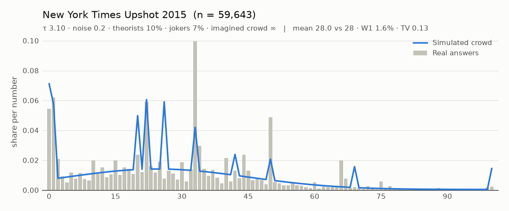
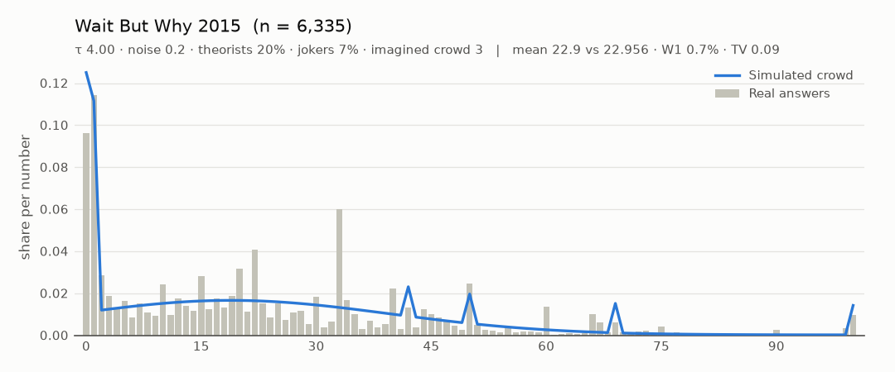
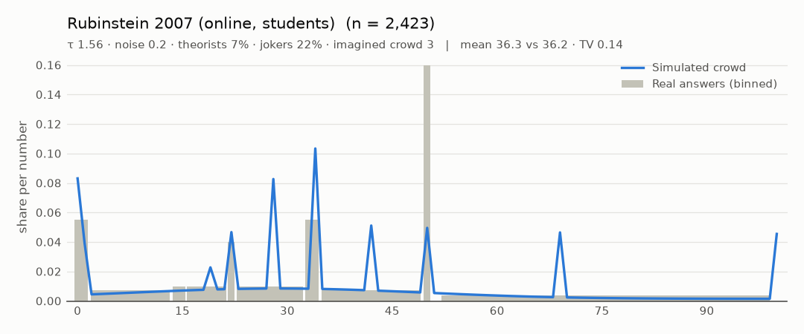

# Calibration

_Generated by `calibration/tools/report.py` from the fit of 2026-10-10. Do not edit by hand._

The simulated crowd is fitted to real answers to the same games. This page lists the sources, how well the model reproduces each one, and how the fits become the daily crowd settings.

## The model being fitted

Each simulated crowd is a mix of:

- **Thinkers, levels 0–4** in Poisson(τ) proportions, truncated at 4. Level 0 plays the template's naive answer (uniform, or high bids in the bid game). Level k best-responds to levels 0..k−1. Its answers are a share `exact` on the best answer plus a Gaussian with sd = `noise` × range.
- **Imagined crowd size (`sample`)**: bots judge each answer against 128 imagined crowds of `sample` players drawn from their belief (payoff sampling, after Osborne & Rubinstein). Small samples mean doubt, which makes cliff-edge answers risky. This is what pulls bids down to 3–5 in the bid game. ∞ means the bots know the crowd exactly.
- **Theorists (`eq`)**: bots who play the game's equilibrium (0 or 1 in the 2/3 game, 100 in "average + 5", a bid of 1). Every real 2/3 game has this spike; the depth cap at level 4 cannot produce it.
- **Jokers (`joker`)**: meme answers such as 0, 100, 69, 42 and 50.

**Loss** = W1 + 20·TV + 10·TV1 + mean error. W1 is the earth-mover distance between the cumulative distributions, in % of the range. TV is the share of answers in the wrong place on 5%-wide bins, and TV1 the same on single numbers (0–100 games only, so the spikes count). The mean error, also in % of the range, is measured against the *reported* mean. Settings are grid-searched, with a finer τ pass at the end. Datasets that only report a mean fit τ alone and borrow the other settings (the median of the published full-histogram fits).

## Sources

| Dataset | n | Game | Data used | Source | Terms |
| --- | --- | --- | --- | --- | --- |
| Financial Times 1997 | 1,468 | 2/3 of the average, 0–100 | histogram (digitised) | [link](https://www.aeaweb.org/articles?id=10.1257/000282802762024737) | Journal article © American Economic Association. Frequencies digitised from Figure 1 (and Figure 3 for the lab summary) for research use; the PDF is not redistributed. |
| Spektrum der Wissenschaft 1997 | 2,729 | 2/3 of the average, 0–100 | histogram (digitised) | [link](https://www.aeaweb.org/articles?id=10.1257/000282802762024737) | Journal article © American Economic Association. Frequencies digitised from Figure 1 (and Figure 3 for the lab summary) for research use; the PDF is not redistributed. |
| Expansión 1997 | 3,696 | 2/3 of the average, 0–100 | histogram (digitised) | [link](https://www.aeaweb.org/articles?id=10.1257/000282802762024737) | Journal article © American Economic Association. Frequencies digitised from Figure 1 (and Figure 3 for the lab summary) for research use; the PDF is not redistributed. |
| Nagel lab 1991-94 (Bonn, Caltech) | 86 | 2/3 of the average, 0–100 | mean only | [link](https://www.aeaweb.org/articles?id=10.1257/000282802762024737) | Journal article © American Economic Association. Frequencies digitised from Figure 1 (and Figure 3 for the lab summary) for research use; the PDF is not redistributed. |
| New York Times Upshot 2015 | 59,643 | 2/3 of the average, 0–100 | histogram (digitised) | [link](https://www.nytimes.com/interactive/2015/08/13/upshot/are-you-smarter-than-other-new-york-times-readers.html) | © The New York Times. Frequencies digitised from the results chart (59,643 guesses) for research use; the chart is not redistributed. The bar at 33 runs off the chart and is inferred as 1 minus the rest. |
| Wait But Why 2015 | 6,335 | 2/3 of the average, 0–100 | histogram (raw) | [link](https://waitbutwhy.com/table/can-you-guess-what-other-readers-are-guessing-results) | Raw responses published openly by the author as a Google Sheet; no licence stated. Only the histogram is kept here; the raw sheet is not redistributed. |
| Rubinstein 2007 (online, students) | 2,423 | 2/3 of the average, 0–100 | bins | [link](https://arielrubinstein.org/papers/78.pdf) | Journal article © Royal Economic Society. Bin shares copied from Table 4 (facts); the PDF is not redistributed. |
| ChessBase 2009 (chess players) | 6,000 | 2/3 of the average, 0–100 | mean only | [link](https://en.chessbase.com/post/6000-che-players-took-part-in-our-beauty-contest) | News article © ChessBase. Only the reported mean (32.21539) and target (21.4769) are used. No histogram was published; n is 'over 6000'. |
| Politiken 2005 | 19,196 | 2/3 of the average, 0–100 | mean only | [link](https://en.wikipedia.org/wiki/Guess_2/3_of_the_average) | Only the reported winning number (21.6, so a mean of 32.4) and n are used. The original Politiken article could not be found online; no histogram is available. |
| YouTube survey (owner-provided) | 3,190–3,206 per question | 2/3, average + 5, percentile rings 0–1000, bid 1–20 | raw answers | [video](https://www.youtube.com/watch?v=sJ7IHSTOzng) | Calibration only. Data and derived histograms are kept in git-ignored `calibration/private/`. |

Notes on individual sources:

- **Financial Times 1997**: Integers 0-100. Digitised mean 20.884 vs reported 18.91: bins of one or two entries are under a pixel, so the reported mean is used as a constraint.
- **Spektrum der Wissenschaft 1997**: Real numbers 0-100, binned to whole numbers. Digitised mean 21.822 vs reported 22.08: bins of one or two entries are under a pixel, so the reported mean is used as a constraint.
- **Expansión 1997**: Real numbers 1-100 (no 0), binned to whole numbers. Digitised mean 22.648 vs reported 25.47: bins of one or two entries are under a pixel, so the reported mean is used as a constraint.
- **Nagel lab 1991-94 (Bonn, Caltech)**: Lab experiments 1-5 (Nagel 1995, 1998), first round, pooled in Figure 3.1 of Bosch-Domènech et al. Undergraduates, 15-18 per session. Mean only (n is too small to digitise usefully).
- **Wait But Why 2015**: 6335 numeric answers in 0-100 after excluding 242 (blank, words, out of range). The author's own cleaning (dropping decimals too) kept 4,940 with mean 22.956.
- **Rubinstein 2007 (online, students)**: 2,423 students in 66 courses via gametheory.tau.ac.il; integers 0-100.
- **Not found online**: the original Politiken article and data, Nagel's raw lab choices, the NYT raw responses and the ChessBase histogram. These are used through their published summaries only.

## Fit quality

| Dataset | τ | noise | exact | theorists | jokers | imagined crowd | model mean | real mean | W1 % | TV | TV1 |
| --- | --- | --- | --- | --- | --- | --- | --- | --- | --- | --- | --- |
| Financial Times 1997 | 3.76 | 0.1 | 0 | 20% | 5% | 2 | 18.89 | 18.91 | 2.29 | 0.10 | 0.24 |
| Spektrum der Wissenschaft 1997 | 4.64 | 0.1 | 0 | 16% | 17% | 2 | 22.07 | 22.08 | 1.20 | 0.12 | 0.25 |
| Expansión 1997 | 2.28 | 0.1 | 0.2 | 10% | 3% | 3 | 25.32 | 25.47 | 2.93 | 0.13 | 0.28 |
| Nagel lab 1991-94 (Bonn, Caltech) | 1.02 | 0.1 | 0 | 10% | 7% | 2 | 35.11 | 35.13 | – | – | – |
| New York Times Upshot 2015 | 3.10 | 0.2 | 0.2 | 10% | 7% | ∞ | 28.01 | 28 | 1.59 | 0.13 | 0.23 |
| Wait But Why 2015 | 4.00 | 0.2 | 0 | 20% | 7% | 3 | 22.94 | 22.956 | 0.74 | 0.09 | 0.21 |
| Rubinstein 2007 (online, students) | 1.56 | 0.2 | 0.4 | 7% | 22% | 3 | 36.29 | 36.2 | – | 0.14 | – |
| ChessBase 2009 (chess players) | 1.34 | 0.1 | 0 | 10% | 7% | 2 | 32.23 | 32.215 | – | – | – |
| Politiken 2005 | 1.32 | 0.1 | 0 | 10% | 7% | 2 | 32.38 | 32.4 | – | – | – |
| YouTube survey: percentile rings 0-1000 | 1.38 | 0.28 | 0 | 0% | 17% | 30 | 443.33 | private | 2.18 | 0.14 | – |
| YouTube survey: points with a catch (2 questions) | 3.06 | 0.04 | 0 | 0% | 22% | 2 | – | private | – | 0.05 | – |
| YouTube survey: least common (2 questions) | 0.10 | 0.28 | 0 | 0% | 35% | ∞ | – | private | – | 0.09 | – |
| YouTube survey: most common (2 questions) | 0.40 | 0.07 | 0 | 0% | 28% | ∞ | – | private | – | 0.16 | – |
| YouTube survey: average + 5 | 1.10 | 0.14 | 0 | 10% | 1% | 2 | 62.45 | private | 0.93 | 0.11 | 0.25 |
| YouTube survey: will more people answer NO than YES? | 0.20 | 0.2 | 0.6 | 0% | 5% | ∞ | – | private | – | 0.00 | – |
| YouTube survey: split or steal with two neighbours | 0.20 | 0.1 | 0 | 0% | 10% | ∞ | – | private | – | 0.00 | – |
| YouTube survey: German tank (10 numbers, max 318) | 0.70 | 0.14 | 0.6 | 0% | 35% | ∞ | – | private | 0.94 | 0.04 | – |
| YouTube survey: threshold options (2 questions) | 1.92 | 0.2 | 0 | 0% | 0% | 15 | – | private | – | 0.09 | – |
| YouTube survey: 2/3 of the average | 2.18 | 0.2 | 0 | 5% | 7% | 3 | 31.45 | private | 0.89 | 0.07 | 0.19 |
| YouTube survey: bid under the average | 5.04 | 0.14 | 0 | 13% | 1% | 2 | 5.64 | private | 3.96 | 0.20 | 0.20 |

For choice games (threshold, most/least common, catch, split or steal), TV is the share of answers on the wrong option, averaged over the questions fitted together. For the YES/NO question it is on the vote.

Reading the table: a W1 of 1% on a 0–100 game means the simulated answers sit about 1 point away from the real ones on average. A TV of 0.10 means 10% of the answers fall in the wrong 5-point bin.

## Overlays (published sources)













The YouTube overlays are in `calibration/private/plots/` and are not published.

## From fits to the daily crowd

**Personas.** Each weekday's crowd is modelled on one real crowd's fit. They are ordered by how low that crowd's 2/3-game mean is, from Monday (36) to Sunday (19, the hardest day, per the house rules). τ alone is not ordered, because theorists and doubt also lower the mean. The date seed jitters τ by ±10%, noise by ±15%, and the theorist and joker shares by ±25%.

| Day | Persona | τ | theorists | jokers | 2/3-game mean |
| --- | --- | --- | --- | --- | --- |
| Monday | students in 66 game theory courses (Rubinstein 2007) | 1.56 | 7% | 22% | 36.3 |
| Tuesday | Politiken readers (2005) | 1.32 | 10% | 7% | 32.4 |
| Wednesday | New York Times readers (2015) | 3.10 | 10% | 7% | 28.0 |
| Thursday | Expansión readers (1997) | 2.28 | 10% | 3% | 25.3 |
| Friday | Wait But Why readers (2015) | 4.00 | 20% | 7% | 22.9 |
| Saturday | Spektrum der Wissenschaft readers (1997) | 4.64 | 16% | 17% | 22.1 |
| Sunday | Financial Times readers (1997) | 3.76 | 20% | 5% | 18.9 |

**Families.** The same YouTube viewers answered every question type, so their fits show how differently people play each kind of game. τ scales by the family's ratio to their 2/3-game τ. The theorist and joker shares, noise, exact share and imagined-crowd size are the family's own fitted values.

| Family | τ × | theorists | jokers | noise | exact | imagined crowd | Fitted on |
| --- | --- | --- | --- | --- | --- | --- | --- |
| beauty (2/3-style, unravels down) | 1 | persona | persona | persona | persona | persona | the personas |
| beautyUp | 0.505 | 10% | 1% | 0.14 | 0 | 2 | average + 5 |
| avoid | 0.633 | 0% | 17% | 0.28 | 0 | 30 | percentile rings 0–1000 |
| underbid | 2.312 | 13% | 1% | 0.14 | 0 | 2 | bid under the average |
| threshold | 0.881 | 0% | 0% | 0.2 | 0 | 15 | 2 threshold questions |
| commonMost | 0.183 | 0% | 28% | 0.07 | 0 | ∞ | most common number, colour |
| commonLeast | 0.046 | 0% | 35% | 0.28 | 0 | ∞ | least common letter, A–D |
| catch | 1.404 | 0% | 22% | 0.04 | 0 | 2 | 2 points-with-a-catch questions |
| splitsteal | 0.092 | 0% | 10% | 0.1 | 0 | ∞ | split or steal, two neighbours |
| selfref | 0.092 | 0% | 5% | 0.2 | 0.6 | ∞ | "more NO than YES?" vote |
| tank | 0.321 | 0% | 35% | 0.14 | 0.6 | ∞ | German tank, max 318 |

## What the fits say, and their limits

- **Crowds differ a lot in depth.** Students and lab subjects fit τ ≈ 1–1.6. Large newspaper and online crowds fit τ ≈ 1.3–3. Self-selected readers of the FT, Spektrum and Wait But Why fit τ ≈ 3.8–4.6, with 16–20% theorists. This is wider than the 1.1–2.0 first assumed, because theorists and doubt now carry part of what τ used to explain.
- **τ is not cleanly identified.** It trades off against the theorist share, noise and imagined-crowd size: several settings fit nearly as well. The personas use each dataset's best joint fit. Treat individual parameters as descriptive, not as measurements.
- **The 1997 newspaper histograms are digitised from the paper's figure.** Bins of one or two entries are under a pixel, so the digitised means are 0.3–3 points off the reported ones. The loss uses the reported mean, which is exact.
- **Weakest fits**: the bid game (the model peaks at 6, while real bids are flat from 1 to 5) and Rubinstein's students, who have a 16% spike at 50 and 20% above 50 ("misunderstood the game", in Rubinstein's words). The model covers that spike with jokers.
- **Upward rules are played shallower.** In "average + 5" the same viewers fit τ ≈ 1.1 against 2.2 in the 2/3 game, so upward rules are their own family (`beautyUp`).
- **Choice games are mostly shallow.** In the most/least common, split-or-steal and YES/NO questions the crowd is close to naive salience plus noise (τ × 0.05–0.2). Threshold options and points-with-a-catch show real thinking (τ × 0.9–1.4) and fit well (TV 5–9%).
- **Weakly identified families.** Split or steal and the YES/NO question each have one free number (the split share, the YES share), so they fit exactly with τ at the bottom of the grid. Their depth is a guess that the Phase 5 recalibration from real players should replace.
- **Most common is the weakest choice fit** (TV ≈ 0.16). Real people pile onto 7 *and* 1 in "most common number"; the salience prior (7, 1 and the top number as focal points) still under-predicts 1. Level 0's salience priors are hand-set, not fitted.
- **The German tank crowd** is the largest-max-seen plus a Bayesian guess, with a large joker share (capped at 30% in the game) for round-ups such as 350, 400 and 500, and double-the-average. It fits closely (W1 ≈ 1%).
- **Not calibrated**: the YouTube group split-or-steal (halves voting as blocs) and the meta questions. No template plays those.

## Reproduce

```
python -I calibration/tools/digitise_bosch.py calibration/raw/bosch2002/fig_p4.png calibration/raw/bosch2002/digitised_fig1.json
python -I calibration/tools/digitise_nyt.py calibration/raw/nyt2015/wbw_nyt_graph.png calibration/raw/nyt2015/digitised.json
python -I calibration/tools/build_datasets.py   # needs calibration/raw and calibration/private
node calibration/fit.js                           # ~25 min; or pass dataset ids
node calibration/apply.js                         # writes site/js/engine/calibrated.js
node scripts/generate.js --regenerate-future      # rewrites future day files only
python -I calibration/tools/plot_fits.py
python -I calibration/tools/report.py
```

The downloads (`calibration/raw/`) are not committed: the source URLs above re-fetch them. Changing `calibrated.js` changes future crowds, so after a refit run `node scripts/generate.js --regenerate-future`: it rewrites only days after today and refuses if a published day would change.
